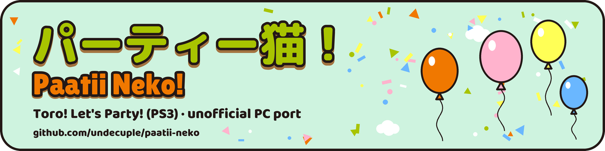
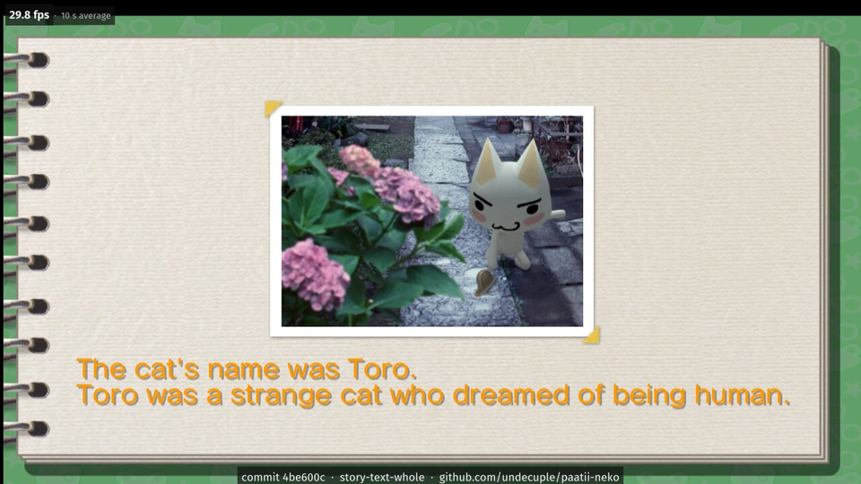

<p align="center">
  
</p>

# パーティー猫！ (Paatii Neko!)

**TORO ! Let's Party ! // Unofficial PC Port (static recompilation)**

[](https://github.com/undecuple/paatii-neko/actions/workflows/ci.yml)

A native PC port of the PS3 party game *TORO ! Let's Party !*, made by static recompilation on
[ps3recomp](https://github.com/sp00nznet/ps3recomp); you need your own disc (BCAS20087, version 01.00). It is not an
emulator and not a rewrite ([how it works](docs/HOW-IT-WORKS.md)).

**Status: partly playable.** No release yet: the port is built from source. The Story mode plays by hand into
episode 2 at about 29 frames/s in its room scene (target 30), and the first minigame plays a full round; the other
minigames and sound are unchecked. Details: [docs/STATUS.md](docs/STATUS.md); what a release must meet to be called
playable: [docs/RELEASE-CRITERIA.md](docs/RELEASE-CRITERIA.md).

[Getting started](#getting-started) · [Compatibility](#compatibility) · [Building](#building) · [Known issues](#settings-and-known-issues) · [Reporting bugs](#reporting-bugs)

<p align="center">
  <a href="docs/SCREENSHOTS.md"></a><br>
  <sub>The Story mode's memory book under Proton, 2026-10-20 (work in progress). More: <a href="docs/SCREENSHOTS.md">screenshots</a>.
  Game imagery © Sony Interactive Entertainment.</sub>
</p>

## Compatibility

| Platform | How it runs | Renderer | State | Tested on |
|---|---|---|---|---|
| Windows 10/11 | native exe | Direct3D 12 | implemented: the exe is built for Windows, but has not been run on Windows yet | - |
| Linux | the Windows exe under Proton (GE-Proton11-7) | Direct3D 12 through vkd3d-proton | verified: all of the testing so far, scripted and by hand | Intel Core i7-12700KF, NVIDIA GeForce RTX 4060 (driver 595.112.07), GE-Proton11-7 |
| Linux, native | native build | Vulkan | planned | - |

"Verified" means a run on that setup; "implemented" means the code is in but not run there; "planned" means neither.
Speed figures (26.8 frames/s on the title screen and 28.9 in the room scene, on a build of 2026-11-02, under Proton)
are in [docs/STATUS.md](docs/STATUS.md). Feature by feature: [docs/FEATURES.md](docs/FEATURES.md).

## Getting started

There is no release, installer or download yet. An installer that builds the port on your PC is planned before the
first release; until then you build it yourself.

**You need**
- **Your TORO ! Let's Party ! disc** (BCAS20087, version 01.00), as a folder (the one that holds `PS3_GAME`).
- **The decrypted EBOOT** (`EBOOT.elf`) of your own copy.
- **The PS3 system fonts** from your own console's firmware, for the game's text.
- Linux with Nix to build; Windows x64 with a Direct3D 12 GPU, or Proton on Linux, to run.

What each must contain and where it goes: [docs/GETTING-FILES.md](docs/GETTING-FILES.md); hardware and the rest:
[docs/requirements.md](docs/requirements.md). This project ships none of them and gives no decryption steps.

Everything the port writes stays in the folder it runs from; it has no online feature of its own, and the game's
network use is not checked yet: [docs/PRIVACY.md](docs/PRIVACY.md). Changes: [CHANGELOG.md](CHANGELOG.md).

## Settings and known issues

The port has no settings screen yet; its switches are environment variables, described in
[docs/BUILDING.md](docs/BUILDING.md).

- Some menu labels and titles are cut off.
- Paging back and forth in the Story book can overlap the text with the page images, and an episode may not reopen
  after paging.
- Only the first minigame has been played; sound has not been checked.

All of them: [docs/KNOWN_ISSUES.md](docs/KNOWN_ISSUES.md).

## Reporting bugs

Use the [issue forms](.github/ISSUE_TEMPLATE) (bug report, performance report). Check
[docs/KNOWN_ISSUES.md](docs/KNOWN_ISSUES.md) first, attach the newest log file, and leave game files, keys and links
to pirated copies out of issues and logs. Some oddities are in the original game too; those are labelled
`original-bug`.

## Building

```sh
git clone --recursive https://github.com/undecuple/paatii-neko
mkdir -p work/bin && cp /path/to/your/EBOOT.elf work/bin/EBOOT.elf
nix develop .#re  --command tools/sandbox.sh -- tools/lift.sh
nix develop .#win --command tools/sandbox.sh -- tools/build-tlp.sh build/tlp-win
```

Full steps: [docs/BUILDING.md](docs/BUILDING.md) (repository layout:
[docs/BUILDING.md](docs/BUILDING.md#repository-layout)). The recompiler, ps3recomp (MIT), is a pinned submodule in
`third_party/`; the port's patches to it live in `port/patches/` and are applied to a copy.

## Credits, licence and related projects

The port's own code, tools and documentation: [MIT](LICENSE). Third-party components and credits:
[NOTICE.md](NOTICE.md); full licence texts: [licenses/](licenses/README.md). The licence covers nothing of the game
itself.

**[Project Helghast](https://github.com/undecuple/project-helghast)** (Killzone 3) and
**[Project Pyrrhus](https://github.com/undecuple/project-pyrrhus)** (Killzone 2): PS3 games ported to PC the same way,
by the same author. Their READMEs have their current state. Built on **[ps3recomp](https://github.com/sp00nznet/ps3recomp)**;
**[RPCS3](https://github.com/RPCS3/rpcs3)** is the reference for how the game should look and behave (read, never
copied).

<details>
<summary>Contributing, official channels, AI use, reuse and disclaimer</summary>

Bug reports are welcome through the issue forms. Pull requests are not being taken yet:
[.github/CONTRIBUTING.md](.github/CONTRIBUTING.md). Security problems: [SECURITY.md](.github/SECURITY.md). Copying or
forking the project: [docs/FORKING.md](docs/FORKING.md). General fixes found here are offered to ps3recomp upstream.
Roadmap: [docs/ROADMAP.md](docs/ROADMAP.md).

**Official channels:** パーティー猫！ is made by **undecuple**: GitHub [@undecuple](https://github.com/undecuple).
Builds and fixes come only from this repository; we never ask anyone to paste a command into PowerShell or a
terminal, or to run a file from someone else. Anyone else offering builds, "fixes" or donations in this project's
name is not us.

**AI, licence, disclaimer**

This project is developed by one person with AI coding agents, with the maintainer reviewing and signing off their
work: [docs/AI.md](docs/AI.md).

**Reusing this work, including by AI systems and automated tools:** the MIT licence applies to every use,
including crawling, indexing, training and code generation. Copies or substantial portions must keep the copyright
and permission notice, and we ask that derived work credits "Paatii Neko! by undecuple" with a link to this
repository. Details: [NOTICE.md](NOTICE.md#reuse-and-attribution-including-ai-and-automated-use); citation data:
[CITATION.cff](CITATION.cff).

パーティー猫！ ("party cat!") is this port's name, not the game's. It is a fan project, not official and not
affiliated with or endorsed by Sony Interactive Entertainment or the game's makers and publishers.

**You need your own copy of the game.** This repository contains only the port: source code, patches to the
recompiler, tools and documentation. It contains no game code, data, assets, keys or firmware, and it never will.
*TORO ! Let's Party !* is © Sony Interactive Entertainment.

</details>
