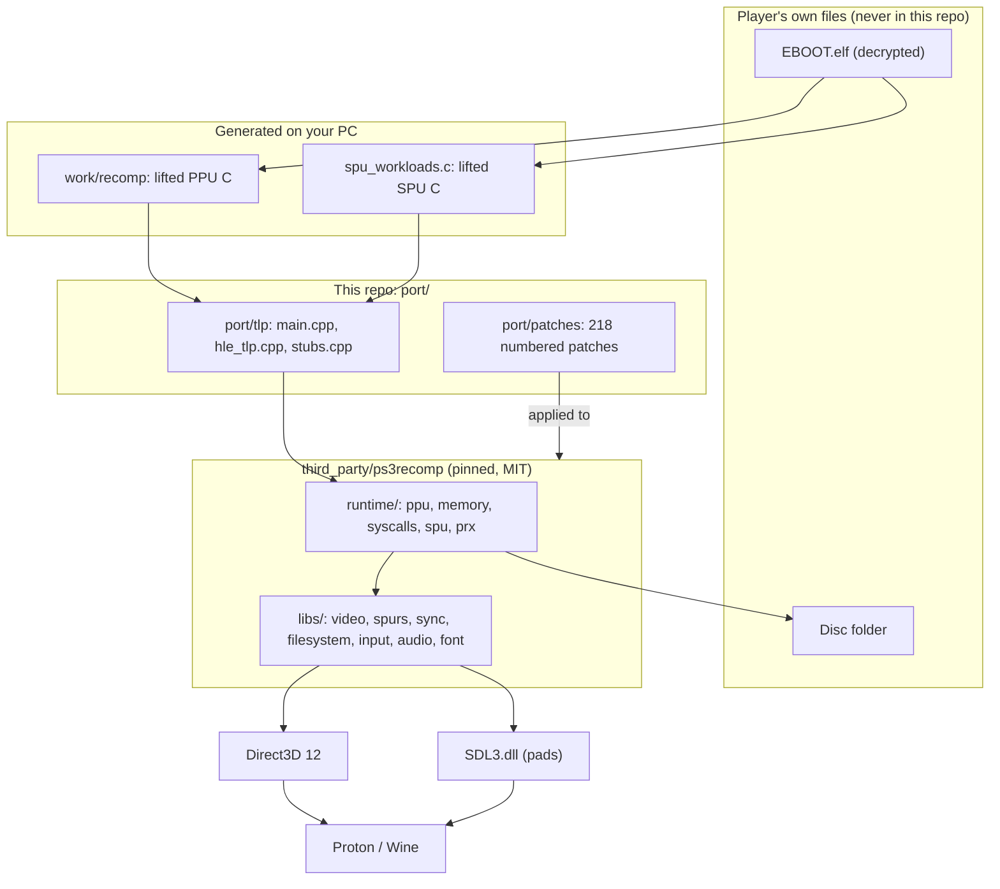
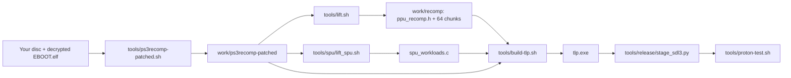
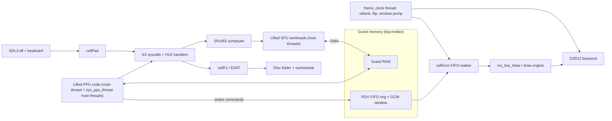
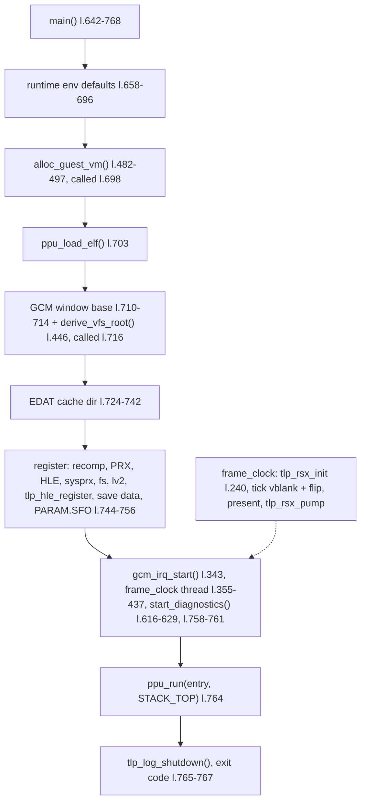

# Code map

A map for people who read or change the code. It lists names and structure only. For what the port is and how it
works in general, read [HOW-IT-WORKS.md](HOW-IT-WORKS.md) first. For build steps, read [BUILDING.md](BUILDING.md).

Everything here was checked against the file tree. Nothing on this page says the game works; see
[FEATURES.md](FEATURES.md) and [KNOWN_ISSUES.md](KNOWN_ISSUES.md) for that. The port has been run only under Proton on
Linux, never on real Windows.

## 1. Modules and layers

| Layer | Where | What it holds |
|---|---|---|
| Host glue | `port/tlp/` | `main.cpp` (boot, frame clock, window, diagnostics), `hle_tlp.cpp` (imports the runtime leaves unresolved), `stubs.cpp`, `tlp_log.h`, `tlp_ppu_overrides.cpp` (empty) |
| Patches | `port/patches/` | 218 numbered changes to ps3recomp, applied in file order (section 1.1) |
| PPU/memory runtime | `runtime/ppu`, `runtime/memory`, `runtime/syscalls`, `runtime/prx` in ps3recomp | ELF loader, register file and ops, HLE import table, boot CRT, cellFs, guest address space, lv2 syscalls |
| SPU runtime | `runtime/spu` | workload registry, lifted threads and jobs, SPURS scheduling, DMA, interpreter fallback |
| System libraries | `libs/` | cellGcm and the RSX replay, SPURS, sync, filesystem and EDAT, pad, audio, font |
| Not used | `runtime/host/host_main.c`, the Metal and Vulkan backends | the port supplies its own `main`; it uses the Direct3D 12 backend |

### 1.1 Patch numbering

The block of a patch number says which area it changes. The scheme comes from the file names.

| Block | Count | Area |
|---|---|---|
| 0xxx | 4 | bring-up: MinGW PPU loader, sys_lwcond layout, VFS miss hook, ELF image load |
| 10xx, 11xx | 95 | SPU and SPURS: interpreter and lifted threads, taskset, kernel threads, SPURS scheduler, LS gates, float and FMA details, diagnostics (1000 has two files) |
| 2xxx | 71 | RSX, GCM and Direct3D 12: samplers, live draw, stencil and depth bias, host timing |
| 3xxx | 6 | PPU lifter and PPU runtime: TLS, jump-table hints, stable chunks, fs stat hook, cellPad script |
| 4xxx | 2 | input: SDL controller on Windows, DualShock 3 pressure and accelerometer |
| 5xxx | 4 | data and media: writable EDAT cache, local trophy store, cellFont outlines, compressed EDAT blocks |
| 7xxx | 24 | late fixes of mixed areas: job chain events, live-draw details, cellFont surface, unresolved-NID log, VMX fmaf |
| 93xx | 11 | backports of upstream ps3recomp pull requests (named `upstream-prNNN-...`) that main does not have yet |
| 99xx | 1 | follow-up to one of those backports |

## 2. Build pipeline

| Step | Tool | In | Out |
|---|---|---|---|
| Patch | `tools/ps3recomp-patched.sh` | `third_party/ps3recomp` + `port/patches/*.patch` | `work/ps3recomp-patched` (only changed files are rewritten, so a build recompiles only what changed) |
| Lift PPU | `tools/lift.sh` | decrypted EBOOT, `port/ppu_overrides.txt` | `work/recomp`, then an audit of the lift |
| Lift SPU | `tools/spu/lift_spu.sh` (with `lift_spu.py`, `gen_spu_register.py`) | the 5 SPU programs built into the EBOOT and the job binaries dumped from a run | `spu_workloads.c` with `tlp_spu_register_all` |
| Build | `tools/build-tlp.sh` with `cmake/mingw-w64.cmake` | the lift output, the patched tree, `port/tlp` | `tlp.exe` (MinGW-w64 cross build from the `win` Nix shell) |
| Stage | `tools/release/stage_sdl3.py` | the SDL3 build from the Nix shell | `SDL3.dll` and its licence next to the exe |
| Run | `tools/proton-test.sh` (with `proton-inner.sh`) | the exe folder | a log folder and a screenshot |
| Wrap | `tools/sandbox.sh` | any command that touches game data | the same command with the game and repo read-only |

Inspect your own files with `tools/disc_info.py` and `tools/elf_info.py`.

## 3. Run-time data flow

- **Memory.** The guest address space is one block with no out-of-bounds guard (`ppu_vm_size = 0`: the whole space is backed). Lifted code reads and writes it
  through `ppu_ops.h` on a register-file context. `alloc_guest_vm` reserves it and `vm_commit_veh` commits pages on
  first touch.
- **PPU threads.** The main thread runs `ppu_run`. Guest threads created through the lv2 syscalls become host
  threads. A call to an address the lift did not translate goes through the address map made by
  `ppu_recomp_register`.
- **SPU and SPURS.** Lifted SPU workloads register by fingerprint. The runtime reproduces the SPURS taskset and job
  chain scheduling and the DMA to guest memory on host threads. An interpreter runs code that was not lifted.
- **RSX.** The game writes commands to a ring. The walker follows get to put, and the decoded commands go to the live
  draw path (default) or the plain Direct3D 12 backend. Vertex and fragment programs are translated to HLSL and
  cached on disk. `frame_clock` ticks vblank and flip.
- **Input.** `cellPad` loads `SDL3.dll` at run time (patches 4010, 4011) and also reads the keyboard.
- **VFS.** `cellFs` maps the PS3 mount points to your disc folder (`derive_vfs_root`). Encrypted and compressed data
  files are decoded on read and cached in `cache/edat` (patches 5002, 5006).

## 4. Boot control flow in `port/tlp/main.cpp`

The boot order is also written as a comment at the top of `main.cpp`. Line numbers are for the file at the time of
writing and drift as it changes.

## 5. Where each area's code lives

| Area | Patches | Port and tool paths | Toolkit paths |
|---|---|---|---|
| spu | 10xx, 11xx, 7001 | `tools/spu/` | `runtime/spu`, `libs/spurs` |
| rsx | 2xxx, 7002-7005 | `port/tlp/main.cpp` (window, frame clock, live-draw setup) | `libs/video` |
| re-data | 5xxx | `tools/disc_info.py`, `tools/elf_info.py`, `tools/release/eboot_ids.py` | `libs/filesystem/edat.c`, `libs/font` |
| core | 0xxx, 3xxx, 4xxx, 93xx, 99xx | `tools/ps3recomp-patched.sh`, `tools/lift.sh`, `tools/build-tlp.sh`, `tools/release/`, `.github/workflows/` | `runtime/ppu`, `runtime/syscalls`, `libs/input` |

One patch can touch another area's files, so use the patch block as a guide, not a
rule.

## 6. Entry points

| Entry | File | Use |
|---|---|---|
| `main()` | `port/tlp/main.cpp` | the exe: `tlp.exe <path to EBOOT.elf>` |
| `tlp_hle_register()` | `port/tlp/hle_tlp.cpp` | extra HLE handlers, called from `main()` |
| `frame_clock`, `gcm_irq_start` | `port/tlp/main.cpp` | frame pacing, vblank and flip, window pump |
| `tools/ps3recomp-patched.sh` | `tools/` | make the patched toolkit copy |
| `tools/lift.sh`, `tools/spu/lift_spu.sh` | `tools/` | lift PPU and SPU code |
| `tools/build-tlp.sh` | `tools/` | build the exe |
| `tools/release/stage_sdl3.py` | `tools/release/` | stage `SDL3.dll` beside the exe |
| `tools/proton-test.sh`, `tools/sandbox.sh` | `tools/` | run under Proton, wrap in a sandbox |
| `tools/disc_info.py`, `tools/elf_info.py` | `tools/` | inspect your own disc and EBOOT |

Environment switches that `main()` reads include `TLP_INJECT_BASE`, `TLP_GCM_IRQ`, `PS3_EDAT_CACHE`, `PS3_VERBOSE`
and `RSX_LIVE_DRAW`. The code is the reference for the rest.

## 7. Test map

| Check | Where it runs | What it checks |
|---|---|---|
| Shell syntax | CI (`ci.yml`, job `checks`) | `bash -n` on every `*.sh` |
| Python compile | CI | `py_compile` on `tools/*.py` and `port/*.py` |
| Patches apply | CI | `tools/ps3recomp-patched.sh` applies all patches to the pinned submodule |
| Host tests | CI | `test_stage_sdl3.py`, `test_recomp_card.py`, `test_release.py`, `test_website.py`, `test_eboot_ids.py`, `test_source_archive.py`, `test_version_agree.py` in `tools/release/`, and `tools/spu/test_spu_jobs.py` (SPU job table on a synthetic ELF): fake PE and ELF files and temporary repos, no game data |
| Project card | CI | `recomp_card.py --no-sfo`: the card agrees with the README and the release criteria |
| Project page | CI | `website.py --check`: the page is up to date and loads only its own files |
| VMX fmaf | by hand | `tools/test-vmx-fmaf.sh` with `tools/tests/vmx_fmaf_test.c`: needs the Nix shell and the patched tree |
| Run checks | by hand, Proton | `tools/runprov.py`, `runprofile_tlp.py`, `tlp_metrics.py`, `runcmp.py`: need your own game and a GPU |

What nothing checks today:

- CI never builds the exe, because the lifted code needs the player's game. A patch can apply and still break the
  build.
- No automated test runs the game, the lift, the SPU runtime, the RSX replay or the pad code.
- The upstream ps3recomp test folders (`runtime/*/tests`, `libs/video/tests`) are not run by this repo's CI.
- The Windows exe has not been run on real Windows. A crash with code 0xC0000409 (fast fail) is likely but unverified here (the Killzone 2 and 3 ports hit it):
  the SPU runtime uses frameless `_setjmp`/`longjmp`, and the exe is built without Control Flow Guard, so it could
  trip if Exploit Protection forces CFG on.
