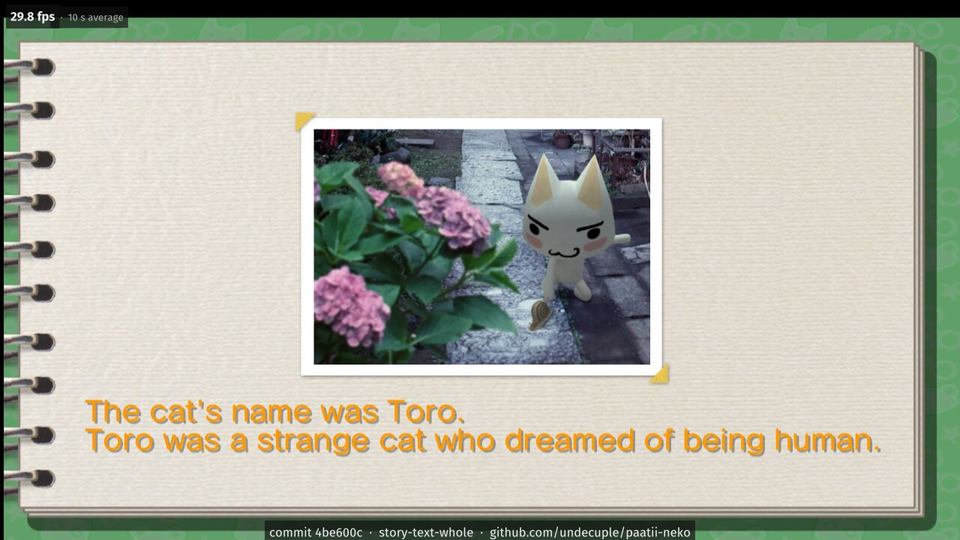

# Screenshots

Screenshots of the port running, in `docs/screenshots/`. Each image carries a bar with the commit of the development tree it was built from and
the project link; where the run logged its frames, the top-left box gives the frame rate over the last 10 seconds
before the shot. The frame rate is that build's own, on the Windows x64 build run under Proton on Linux.

The game's imagery in these screenshots belongs to its owners, shown only to document the port (see
[NOTICE.md](../NOTICE.md)). They come from the developer's own copy of the game.

No studio or platform logo shot is used as a lead image.

| Image | What it shows |
|---|---|
| [story-book.png](screenshots/story-book.png) | The Story mode's memory book: a photo of Toro beside a path of hydrangeas, with the narration "The cat's name was Toro. Toro was a strange cat who dreamed of being human." Taken 2026-10-20 under Proton. |

